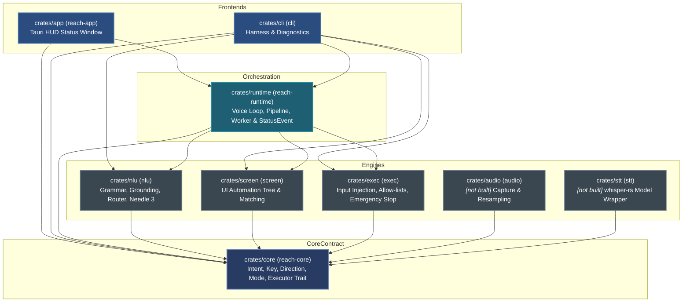
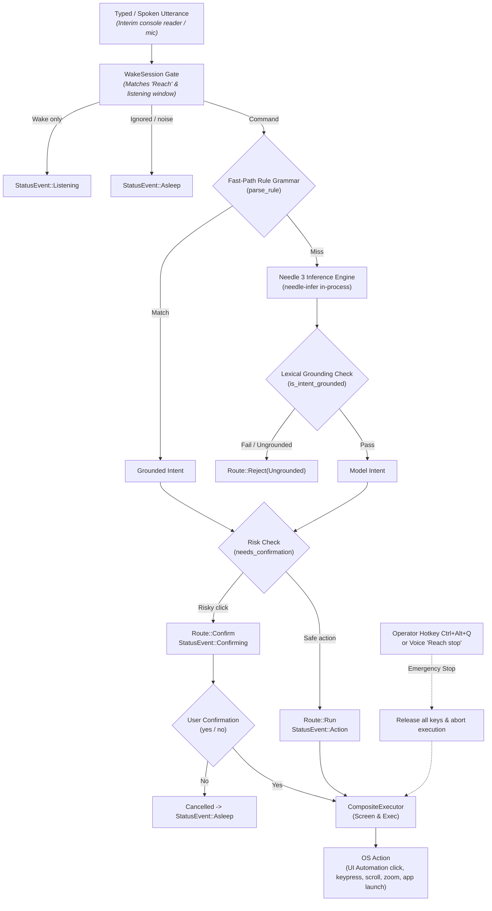

# Reach

**Reach** is a fully local, in-process Windows desktop application that enables hands-free computer control by speech for people who cannot operate a physical keyboard or mouse.

Everything runs strictly on-device. Audio, transcripts, and screen context never leave the machine. There are no cloud calls, no telemetry, no local HTTP servers, and no background daemon processes.

Demo video link: https://drive.google.com/file/d/1kNpJpsfZPbPY0J4s7MJGl8-6DMAPv0oa/view?usp=sharing
---

## 1. Architecture

Reach is organized as a Cargo workspace with strict layer boundaries. Shared types are defined in `reach-core`, speech and language understanding are handled by `nlu` (combining a fast-path rule grammar with the in-process **Needle 3** model), input injection is managed by `exec`, screen accessibility inspection is handled by `screen`, orchestration is housed in `reach-runtime`, and front ends include `cli` and `reach-app` (Tauri).

### Crate Dependency Graph



### Voice Pipeline (As Implemented)



---

## 2. Component Implementation Status

| Crate | Package Name | Responsibility | Implementation Status |
|---|---|---|---|
| `crates/core` | `reach-core` | Typed `Intent` contract, `Direction`, `Key`, `Mode`, `Executor` trait, `needs_confirmation` | **Built** |
| `crates/nlu` | `nlu` | Rule grammar, number words, lexical grounding (`grounding.rs`), confidence routing (`routing.rs`), tool specs, Needle 3 model runner | **Built** |
| `crates/screen` | `screen` | Windows UI Automation collector, fuzzy label matching, bounding box centers | **Built** *(OCR and numbered overlays are not built)* |
| `crates/exec` | `exec` | Input injection (Enigo), modifier guards, Chrome/Notepad/Explorer allow-lists, URL validation, global emergency stop hotkey | **Built** |
| `crates/runtime` | `reach-runtime` | Shared voice loop orchestration, wake session, `Pipeline`, `CompositeExecutor`, `run_worker`, `StatusEvent`, `ErrorKind` | **Built** *(audio/STT integration not built)* |
| `crates/cli` | `cli` | Command-line harness: direct utterance, JSON intents, interactive `pipeline` mode, dry-run JSON reporting, screen dump utility | **Built** |
| `crates/app` | `reach-app` | Tauri always-on-top status HUD window, click-through configuration, IPC status forwarder, interim console reader | **Built** *(P9 overlays not built)* |
| `crates/audio` | `audio` | Microphone capture (`cpal`) and resampling (`rubato`) | **Not built** *(scaffolding only)* |
| `crates/stt` | `stt` | Speech-to-text (`whisper-rs`) wrapper | **Not built** *(scaffolding only)* |

---

## 3. Build & Setup Instructions

### Prerequisites
1. **Operating System:** Windows 10 or Windows 11 (MSVC toolchain).
2. **Build Tools:** Visual Studio 2022 Build Tools with the **C++ build tools** workload installed.
3. **CMake:** Installed and accessible in your system `PATH`.
4. **LLVM / Clang:** Installed (required by `whisper-rs-sys` and `bindgen`). Ensure `LIBCLANG_PATH` is set:
   ```powershell
   $env:LIBCLANG_PATH = "C:\Program Files\LLVM\bin"
   ```
5. **Rust:** Rust 1.85+ (stable MSVC, 2024 edition support).

### Model Assets
Place required model weights into the `models/` directory in the repository root:
- `models/needle3.cact` (Needle 3 tool-calling model, ~35 MB)
- `models/ggml-base.en.bin` or `models/ggml-tiny.en.bin` (Whisper STT model weights)

### Building and Testing
Run commands individually in Windows PowerShell:

```powershell
# Build entire workspace
cargo build --workspace

# Check compilation of all targets
cargo check --workspace --all-targets

# Run all unit tests
cargo test --workspace

# Run code formatting check
cargo fmt --all -- --check

# Run Clippy with zero warnings tolerated
cargo clippy --workspace --all-targets -- -D warnings
```

---

## 4. Privacy & Local-Only Guarantees

Reach operates entirely offline. No audio, screenshots, transcripts, or UI element names are ever written to persistent disk logs or transmitted across networks.

An audit of all logging and standard output calls across `crates/*/src/` confirms:
- **No network clients:** `reqwest`, `hyper`, or remote HTTP libraries are completely absent from workspace dependencies.
- **No telemetry:** Neither `tracing` nor `log::` crates are configured to persist user interactions.
- **Production Console Output:** Restricted strictly to user-facing results and errors in the CLI binary (`crates/cli/src/main.rs:28, 85, 95, 102`) and startup errors in the desktop shell (`crates/app/src/main.rs:51`).
- **Private Error Kinds:** The status window and runtime event channel (`StatusEvent::Error { kind }`) expose only high-level categories (`Model`, `Execution`, `Io`, `Internal`), ensuring private error messages, paths, and element names never leak to the front end.

---

## 5. Safety Architecture

Reach controls a real PC on behalf of a person who may have no physical way to intervene. Safety is built into every layer:

1. **Closed `Intent` Contract (`reach-core`):**
   Models cannot produce shell commands, arbitrary command lines, or code. The only output is a closed, typed enum variant of `reach_core::Intent`.
2. **Lexical Grounding (`crates/nlu/src/grounding.rs`):**
   Before any model output is accepted, `is_intent_grounded` checks that the user's spoken utterance contains explicit trigger words for the requested tool and that all string or numeric arguments (element names, numbers, text) were genuinely spoken by the user.
3. **Confidence & Risk Routing (`crates/nlu/src/routing.rs`):**
   - Untrusted model calls that fail to parse, hallucinate undeclared tools, or contain ungrounded arguments are rejected.
   - Irreversible actions identified by `Intent::needs_confirmation()` (e.g. clicking buttons containing "submit", "delete", "pay", "buy", "confirm", "remove", "sign out") are never executed automatically; they require explicit verbal or UI confirmation.
4. **Execution Allow-Lists (`crates/exec/src/lib.rs`):**
   - Application launching (`validate_app_name`) is strictly restricted to an allow-list: Google Chrome (`chrome.exe`), Windows Notepad (`notepad.exe`), and File Explorer (`explorer.exe`).
   - Web URL navigation (`validate_url`) strictly enforces `http://` or `https://` schemes, rejecting `file://`, `javascript:`, `data:`, or shell-injection vectors.
5. **Global Emergency Stop (`crates/exec/src/emergency_stop.rs`):**
   - A dedicated Win32 thread running an independent message loop monitors a global operator hotkey (`Ctrl+Alt+Q` to stop, `Ctrl+Alt+R` to resume).
   - When triggered, it atomically sets an `Arc<AtomicBool>` STOP flag, immediately releases all modifier keys and mouse buttons via `release_all_keys()`, cancels pending confirmations, and aborts any in-flight execution.
   - The executor checks `is_stopped()` before every injected action.
   - For voice-only users, the accessible command `"Reach stop"` transitions the system to `Mode::Sleep`.

---

## 6. Credits & Licensing

- **Needle Inference Engine:**
  - Runtime crate: `needle-infer` (version 0.3.1).
  - Repository: [https://github.com/geekgineer/needle-rs](https://github.com/geekgineer/needle-rs).
  - License: **MIT License**, verified in `needle-infer-0.3.1/Cargo.toml` (`license = "MIT"`).
- **Needle 3 Model Weights:**
  - Model file: `models/needle3.cact`.
  - License: **Apache-2.0**.
- **OpenAI Whisper-base:**
  - Repository: [https://huggingface.co/openai/whisper-tiny](https://huggingface.co/openai/whisper-tiny)
  - License: **Apache-2.0**
- **OpenAI Whisper-tiny:**
  - Repository: [https://huggingface.co/openai/whisper-tiny](https://huggingface.co/openai/whisper-tiny)
  - License: **Apache-2.0**
- **Reach Project:**
  - Developed by Team Thinkers for hands-free Windows accessibility.

---

## 7. Known Limitations

- **Interim Speech Input:** Audio capture (`crates/audio`) and STT (`crates/stt`) are not yet linked to the main orchestration loop; the current application reads typed utterances line-by-line from standard console input as a temporary stand-in (`crates/app/src/main.rs:296-323`).
- **UI Automation Fallbacks:** The numbered screen overlay and 3x3 mouse grid (P9) are not yet implemented; element targeting currently relies exclusively on Windows UI Automation element names and bounding boxes (`crates/screen`).
- **Application Scope:** Application launching is restricted to Chrome, Notepad, and Explorer (`crates/exec/src/lib.rs:224-263`).
- **Non-Accessible UI Trees:** Windows or custom controls that do not expose accessible labels or bounding boxes through Microsoft UI Automation cannot currently be targeted until OCR fallbacks are added.
- **Performance Metrics:**
  - Utterance corpus accuracy pass rate: **[TODO: corpus pass rate %]**
  - Model inference latency (Needle 3 on CPU at 6, 8, and 20 layers): **[TODO: latency in ms]**
  - Speech-to-text Word Error Rate (WER): **[TODO: WER %]**
  - Idle and active RAM consumption: **[TODO: memory footprint in MB]**
  - Total test suite count: **[TODO: exact passing test count]**
